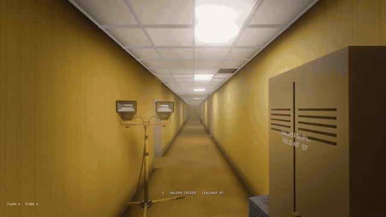
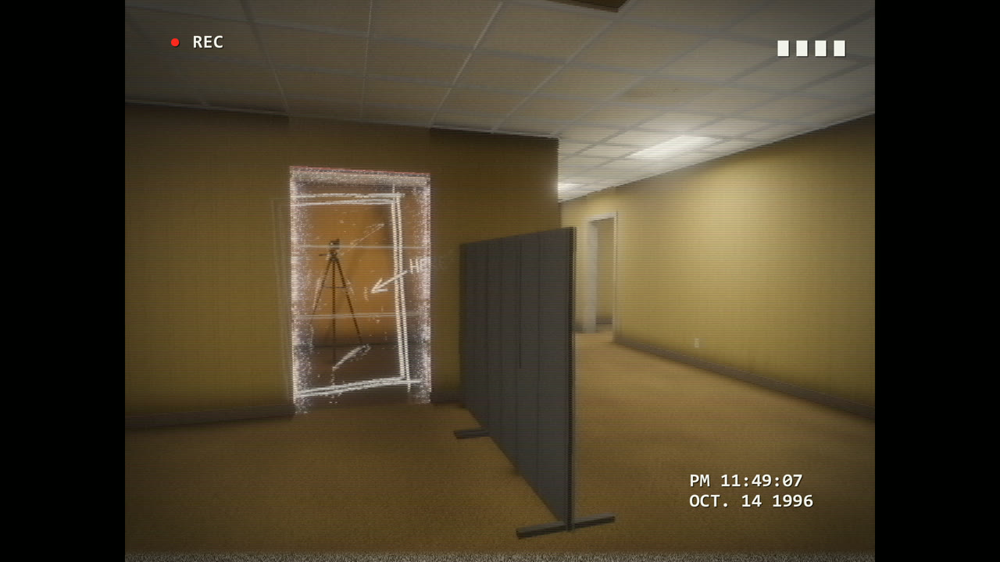
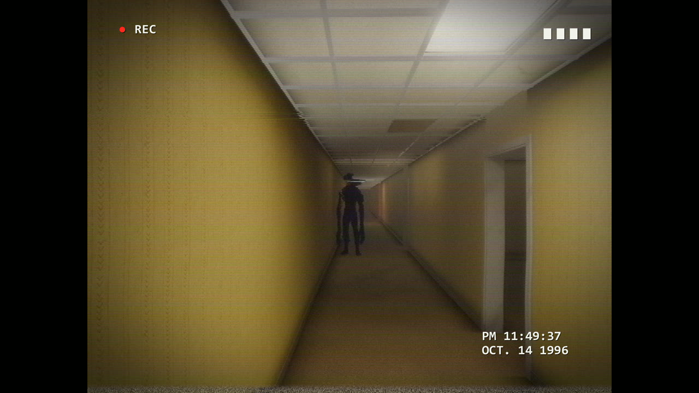
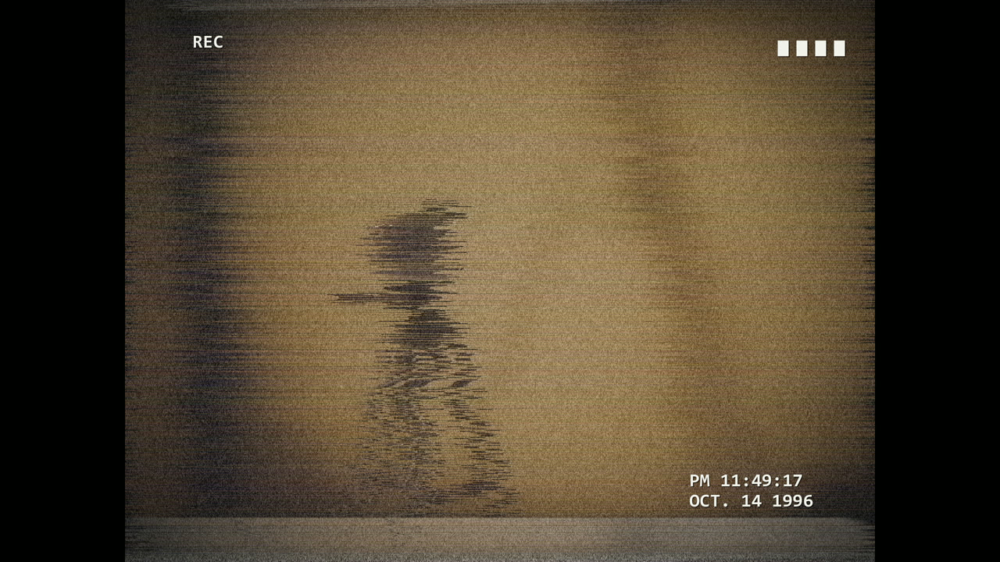
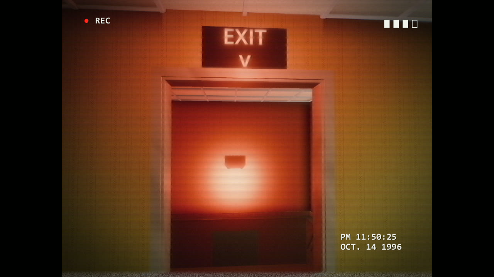
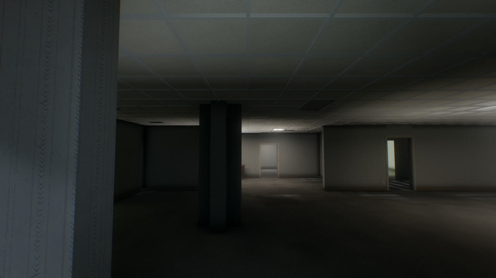
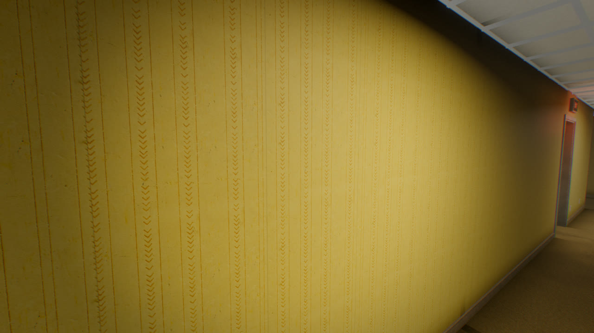

# NOCLIP


First-person surreal horror in the Backrooms, where your camcorder sees the doors, marks and monster you can't.



**[Landing page](https://noclip.pages.dev)** · No public build yet: it runs from source (see below).

## What it is

You were closing up the furniture store when you found a wall in the back outlined in duct tape, and you walked through it. Now there is carpet that never dries, a hum that never stops, and fluorescent light falling on rooms nobody built. Every place down here is a copy of a real place, dubbed from a dub until the details slip: doors with no handles, signs that almost read, rooms bigger inside than out. Your camcorder shows what the place really is, including the thing that hunts the halls by sound. You will die often; your tapes sell for salvage at a company post near the entrance, you buy a flashbulb, flares and quieter shoes, and you take the stairwells deeper, where the copy gets worse.

## Screenshots

| | |
|---|---|
|  |  |
|  |  |
|  |  |

All stills and clips come from the game's own capture harness: an autoplay bot on a random seed, nothing hand-posed.

## How it was made

- **Engine:** Godot 4.7 (Forward+, GDScript) with realtime global illumination, volumetric fog and area lights. It won a blind look bake-off against three.js WebGPU in the first session.
- **Procedural and seeded:** Level 0 streams in chunks built from a seed (rooms, highways, loops, splices), so one seed rebuilds a level exactly. Impossible spaces include rooms bigger inside and doors the camcorder reveals in solid walls.
- **Assets by script:** Blender runs headless for every model fix-up and export; props are CC BY models from Sketchfab, rescaled and re-exported (credited below). The creature was concepted with Gemini, modeled and rigged through Meshy, and picked by a blind panel of AI judges. Sound effects and ambience were generated with ElevenLabs. Every generated asset has its prompt and parameters recorded under `pipeline/manifests/`.
- **Blind review loop:** each session a capture tool records stills, motion contact sheets and a two minute video with audio, then two critics who never see the code (Claude on stills, Gemini on the video and sound) score it like players. 31 rounds so far, logged in `review/scores.csv` and `review/critiques/`, with every complaint triaged in `review/LEDGER.md`.
- **Built by:** Claude (Anthropic) as lead developer across seven sessions from October 1 to 3, 2026, with Stewart directing and play-testing. The progress pictures in `progress/` show the whole history, one dated image at a time.

## Run it locally

Needs Windows, [Git LFS](https://git-lfs.com) (models, textures and audio are stored in LFS) and Godot 4.7.2.

```powershell
winget install GodotEngine.GodotEngine; git lfs install; git clone https://github.com/Samizdat-Publications/noclip.git; cd noclip; & ".\Play NOCLIP.bat"
```

WASD to move, mouse to look, Shift to sprint, Ctrl to crouch, hold right mouse for the camcorder, F for the flashbulb, G for a flare, F3 for the performance overlay, Esc to pause.

## Credits

Props are Sketchfab models used under [Creative Commons Attribution 4.0](https://creativecommons.org/licenses/by/4.0/). All were changed for the game: rescaled to meters, re-oriented and re-exported to glTF, with the further changes noted.

| File in game | Title (link) | Author | Licence | Changes beyond rescale and re-export |
|---|---|---|---|---|
| prop_crt_monitor_sf.glb | [CRT Monitor (remodel)](https://sketchfab.com/3d-models/crt-monitor-remodel-95f4083ec9f4443c8d4bd10473c669ff) | ECEL_GAMES | CC BY 4.0 | Meshes merged |
| prop_cardboard_box_sf.glb | [Box](https://sketchfab.com/3d-models/box-3c8b08023b61484aa583994da991274c) | Artem Goyko | CC BY 4.0 | Meshes merged |
| prop_office_chair_alt_sf.glb | [Office chair (used)](https://sketchfab.com/3d-models/office-chair-used-e004c2eb29444df689bef4018f9409d5) | SlagPerch 3D | CC BY 4.0 | Decimated from 35972 to 14999 triangles |
| prop_folding_chair_sf.glb | [Simple metal foldable chair](https://sketchfab.com/3d-models/simple-metal-foldable-chair-c5bc470c3c9b4dc190f654cd7ac1405b) | neverfollow81 | CC BY 4.0 | Meshes merged |
| figure_tape.glb | [Eric Rigged 001 - Rigged 3D Business Man](https://sketchfab.com/3d-models/eric-rigged-001-rigged-3d-business-man-a46bc9f67aaa415bb4f3241eef900e7f) | Renderpeople | CC BY 4.0 | Animations and shape keys dropped, textures replaced by one neutral material, armature kept |
| prop_tripod_sf.glb, prop_tripod_camcorder.glb | [Camera With Tripod](https://sketchfab.com/3d-models/camera-with-tripod-cc324baf6dc548de965c3a47b87f1e27) | FatWasHere | CC BY 4.0 | Camera parts removed, tripod legs kept; one version carries the game's camcorder |
| prop_vhs_tape_sf.glb | [Retro Vhs Tape (Game Ready)](https://sketchfab.com/3d-models/retro-vhs-tape-game-ready-92de31c367ca4f5794f8fb12dce68111) | erlangga da | CC BY 4.0 | Laid flat, scaled to 187 mm; ten copies also stand in the tape crate |
| prop_tape_crate.glb | [Plastic Crate](https://sketchfab.com/3d-models/plastic-crate-7b9426222f0c4838bfbc13850095bb3f) | Dabbre | CC BY 4.0 | Joined with ten VHS tapes |
| prop_worklight_sf.glb | [Industrial Work Light](https://sketchfab.com/3d-models/industrial-work-light-ff0abe17dc64498191bb41c905d00ab0) | denis_cliofas | CC BY 4.0 | Scaled to 1.75 m |
| prop_worklight_box_sf.glb | [Work Light](https://sketchfab.com/3d-models/work-light-278dd26f90d544a8941d347bef0ebf40) | HippoStance | CC BY 4.0 | Scaled to 0.40 m |
| camcorder_v2.glb | [Panasonic NV-G120 VHS-C CAMERA](https://sketchfab.com/3d-models/panasonic-nv-g120-vhs-c-camera-802d634fb1f745f2b528109661acd2c9) | PetyaPetr | CC BY 4.0 | Brand logo meshes deleted |
| prop_water_cooler_sf.glb | [Water-Cooler](https://sketchfab.com/3d-models/water-cooler-52946497074c4c669d620ce5f431a3da) | GroundZer0 | CC BY 4.0 | Meshes merged |
| prop_filing_cabinet_sf.glb | [Rusty Filing Cabinet](https://sketchfab.com/3d-models/rusty-filing-cabinet-619484b78fbe449ea5c0cdb68e8f2bd6) | Amiel Goco | CC BY 4.0 | Drawers left staggered, merged |
| prop_step_ladder_sf.glb | [Step Ladder](https://sketchfab.com/3d-models/step-ladder-670ef4373d544ea5ab577ef00161ffc3) | louis-muir | CC BY 4.0 | None |
| prop_mop_bucket_sf.glb | [Mop Bucket & Safety Cones \| Props](https://sketchfab.com/3d-models/mop-bucket-safety-cones-props-54a8250e1de8426e9cf2bf35fd099a10) | GAMICO | CC BY 4.0 | Cones deleted, joined with the mop below |
| prop_mop_bucket_sf.glb (mop) | [Mop](https://sketchfab.com/3d-models/mop-420bddb8730c4e3aa7653e5f7c5a5a7c) | ZachWilkins1997 | CC BY 4.0 | Placed leaning in the bucket |
| prop_cubicle_panel_sf.glb | [Office Desk_7_MB](https://sketchfab.com/3d-models/office-desk-7-mb-18abda12d33b4231aa13f92a291c717e) | Mehdi Shahsavan | CC BY 4.0 | Two partition panels cut out, fabric UVs remapped, darkened, feet added |
| prop_office_desk_sf.glb | [Office Desk - 18MB](https://sketchfab.com/3d-models/office-desk-18mb-2039a113435b47d585b2c51e4f3a096d) | Mehdi Shahsavan | CC BY 4.0 | Non-uniform rescale to 1.60 x 0.80 x 0.75 m |
| prop_stack_chairs_sf.glb | [Aged Plastic Garden Chair](https://sketchfab.com/3d-models/aged-plastic-garden-chair-4a92b3b9964c446cb5ec9eff053d830c) | Nikoleta.Zhecheva | CC BY 4.0 | Five copies nested in a stack |

The full change log per model is in [docs/CREDITS.md](docs/CREDITS.md). Fonts on the landing page are VT323, IBM Plex Mono and Archivo Narrow from Google Fonts (SIL Open Font License).

NOCLIP is an original game inspired by Backrooms internet folklore. Its world, creature, company and wallpaper are its own.

## Licence

Code is MIT (see [LICENSE](LICENSE)). Third-party assets listed above keep their own licences.
